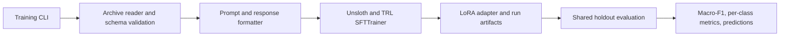

# Vi-ExToxic

Explainable Vietnamese toxicity detection for social media text.

**Project:** SE363, 2026

**Current status:** Phase 1 teacher annotation is available; phases 2 and 3 are skipped; phase 4 SFT and evaluation tooling is implemented.

**Results:** Pending. No model has been trained or evaluated by this repository yet.

## Overview

Vi-ExToxic studies whether a small instruction model can classify Vietnamese social-media comments and provide a concise explanation.

The phase 1 annotations contain the input text, an emotion label, teacher-written explanation fields, a categorical toxicity label, and a teacher confidence score.

The phase 4 training setup supports two response targets using the same input rows and evaluation set:

- **Label-only baseline:** the student predicts the final label.
- **Explanation-distilled SFT:** the student predicts the teacher explanation fields and final label.

This is an exploratory response-target comparison on teacher-generated annotations.

It does not establish that distillation is better than human-grounded supervision.

## Current project status

| Stage | Status | Notes |
| --- | --- | --- |
| 1. Teacher annotation | Available | Annotation CSVs are stored in `data/archive.zip`. |
| 2. Cross-verification | Skipped | Not performed because of resource constraints. |
| 3. Cultural review | Skipped | Not performed because of resource constraints. |
| 4. Student SFT | Tooling implemented | Unsloth LoRA SFT is configured; Kaggle GPU is the intended training environment. |
| Evaluation | Not run | Baseline and distilled Macro-F1 values remain pending. |

## Data

The source archive is `data/archive.zip` and is read directly by the training pipeline.

The scripts do not need to extract or rewrite this archive.

| Archive member | Rows | Use |
| --- | ---: | --- |
| `dataset_phase_1.csv` | 2,774 | Preferred training data. It contains one repeated input text. |
| `labeled_test_dataset_phase_1.csv` | 320 | Frozen teacher-labeled holdout for exploratory evaluation. |
| `blanced_train_dataset_phase_1.csv.csv` | 3,810 | Older resampled file. It has 1,334 rows beyond its 2,476 unique inputs and is not the default. |
| `short_dataset.csv` | 5 | Small example set, not a training or evaluation set. |

The train and holdout files have no exact `input_text` overlap.

This check does not rule out paraphrases or source-level overlap.

The holdout labels are teacher-generated, and no evidence shows that they were independently verified by human annotators.

The holdout is highly imbalanced: it contains 231 `Constructive/Clean`, 53 `Explicit Hostility`, 29 `Implicit Toxicity`, 6 `Identity-Based Hate`, and 1 `Ambiguous/Noise` examples.

Report Macro-F1 together with per-class support, and interpret the score as exploratory because several class counts are too small for a stable estimate.

Required training fields are `input_text`, `input_emotion`, and `final_label`.

Explanation-distilled SFT also uses `semantic_decoding`, `slang_interpretation`, `contextual_conflict`, `target`, and `thought_trace`.

Allowed labels are `Constructive/Clean`, `Implicit Toxicity`, `Explicit Hostility`, `Identity-Based Hate`, and `Ambiguous/Noise`.

The `confidence_score` field is the teacher's self-reported confidence and is not an independent quality measure.

The preferred training file has the following label counts:

| Label | Training rows |
| --- | ---: |
| `Constructive/Clean` | 1,694 |
| `Explicit Hostility` | 458 |
| `Implicit Toxicity` | 444 |
| `Ambiguous/Noise` | 149 |
| `Identity-Based Hate` | 29 |

## Architecture

The training path separates data validation and response formatting from the Unsloth/TRL training adapter.

The CLI owns argument parsing and orchestration, while the trainer owns model loading, LoRA configuration, checkpointing, and adapter output.

The archive is an immutable input; model caches, checkpoints, predictions, and metrics belong in an explicit output directory.



See [the architecture notes](docs/architecture.md) and [the phase 4 contract](docs/phase4-plan.md).

## Repository layout

```text
app/                  Early inference and UI prototypes; not part of the phase 4 training path.
data/processed/       Cleaned source corpus from the earlier data work.
data/raw/             Original Excel files.
docs/                 Architecture and phase 4 contract.
notebooks/            Phase 1 exploration and annotation notebooks.
src/                  Earlier data-processing, annotation, and evaluation scripts.
training/             Phase 4 dataset, prompt, training, and evaluation code.
utils/                Text-processing utilities and slang list.
```

The earlier app and phase 1 scripts are research prototypes.

Their mocked inference and streaming behavior must not be presented as a trained or production model.

## Requirements

- Python 3.12 is recommended for the training environment.
- An NVIDIA GPU with CUDA is required for Unsloth training.
- The default student is `unsloth/Qwen2.5-3B-Instruct-bnb-4bit`, following the model family referenced in the existing project.
- A Kaggle GPU session is the intended training target; the local GTX 1660 Ti has 6 GB VRAM and is intended only for lightweight validation.
- Docker CLI is optional. A running Docker Engine is required to build the container, and NVIDIA GPU support is required to train inside it.
- Hugging Face authentication is only needed if the selected model or dataset requires gated access.

Unsloth currently supports Python 3.10 through 3.12 in its installation guidance.

Use the official [Unsloth installation guide](https://docs.unsloth.ai/get-started/installing-%2B-updating/pip-install) to select a compatible PyTorch and CUDA stack for the chosen runtime.

The project uses TRL's `SFTTrainer` and `SFTConfig` interfaces; see the [official TRL SFTTrainer documentation](https://huggingface.co/docs/trl/en/sft_trainer).

## Local setup

Create an isolated Python 3.12 environment before installing the training dependencies.

```powershell
py -3.12 -m venv .venv
.\.venv\Scripts\Activate.ps1
python -m pip install --upgrade pip
```

Follow the [training setup guide](training/README.md) for dependency installation and validation commands.

The local GPU in the development environment has 6 GB VRAM, so full Qwen 3B fine-tuning is not the local acceptance target.

## Kaggle training

1. Create a Kaggle notebook with a GPU accelerator and attach the `quyenuit24/vi-extoxic` dataset.
2. Enable notebook Internet so the runtime can download the base model.
3. Install dependencies, then run from writable storage while adding the mounted source package to `PYTHONPATH`:

   ```python
   !pip install -r /kaggle/input/datasets/quyenuit24/vi-extoxic/training_bundle/training/requirements.txt
   %cd /kaggle/working
   %env PYTHONPATH=/kaggle/input/datasets/quyenuit24/vi-extoxic/training_bundle
   %env HF_HOME=/kaggle/working/.cache/huggingface
   %env HF_HUB_CACHE=/kaggle/working/.cache/huggingface/hub
   %env XDG_CACHE_HOME=/kaggle/working/.cache
   !mkdir -p /kaggle/working/.cache/huggingface/hub /kaggle/working/unsloth_compiled_cache /kaggle/working/huggingface_tokenizers_cache
   ```

4. Run label-only and explanation-distilled jobs with the same model, seed, sequence length, and optimizer settings.
5. Save adapters, checkpoints, configuration, and metrics under `/kaggle/working`, then download or publish them before the session ends.

Kaggle sessions cannot access the local `D:\Vi-ExToxic` path directly.

The selected archive must be attached or uploaded to the notebook environment.

The [Kaggle upload guide](kaggle_upload/README.md) documents the upload flow, and the [one-file bundle](dist/vi-extoxic-kaggle-upload.zip) is ready to extract and upload.

After each SFT run, `training.publish_model` merges the LoRA adapter into 16-bit weights and uploads the merged model to a Hugging Face model repository.

The Kaggle Notebook should have a Secret named `HF_TOKEN` with model repository write access.

Repositories are private by default, and the label-only and distilled runs should use separate repository IDs.

```python
!python -m training.publish_model --adapter /kaggle/working/outputs/label-only/adapter --repo-id YOUR_HF_USERNAME/vi-extoxic-label-only --target-mode label-only
!python -m training.publish_model --adapter /kaggle/working/outputs/distilled/adapter --repo-id YOUR_HF_USERNAME/vi-extoxic-distilled --target-mode distilled
```

Authenticate locally with `hf auth login` and download the published model using `hf download YOUR_HF_USERNAME/vi-extoxic-label-only --local-dir models/label-only`.

The downloaded model is the input artifact for the next step: connecting model inference to the local UI for hands-on testing.

## Docker

The training Docker image is an optional environment for a machine with a running Docker Engine and NVIDIA container support.

Docker is not required on Kaggle.

Windows users need Docker Desktop with its WSL 2 engine and NVIDIA GPU support to train inside the container.

Use the Docker build and run commands in `training/README.md` after enabling NVIDIA GPU support in Docker.

Docker image builds do not download the model weights; model loading occurs when the training command runs.

## Evaluation and reporting

Run both target modes against the same frozen holdout with identical decoding settings.

The evaluation report should include Macro-F1, per-class precision/recall/F1 and support, a confusion matrix, and row-level predictions.

Keep raw model outputs and the evaluated predictions with the run configuration so the reported values can be reproduced.

Do not fill in the CV metrics until both runs have completed and the evaluation artifacts have been reviewed.

## CV summary

**Vi-ExToxic | Explainable Vietnamese Toxicity Detection (2026)**

**SE363 - Teacher labeling, LoRA SFT and response-target comparison**

- Prepared teacher annotations for Vietnamese social-media comments with toxicity labels and concise explanations.
- Set up a label-only LoRA SFT baseline and an explanation-distilled student run using a shared evaluation protocol.
- Compare both runs on the same teacher-labeled holdout; results are exploratory because the holdout has sparse classes and is not independently verified.
- Results pending: Baseline Macro-F1 ____ · Distilled Macro-F1 ____ · Difference ____.

## Limitations

- Phases 2 and 3 were skipped because of resource constraints.
- Teacher annotation confidence is not independent verification.
- The 320-row holdout has only one `Ambiguous/Noise` example and six `Identity-Based Hate` examples.
- The repository currently contains no completed SFT run, adapter, or verified model metrics.
- The inference app and streaming UI are prototypes and can return mocked outputs.

## License

No license file is currently present in this repository.

Add a license before redistributing the project or its data.
