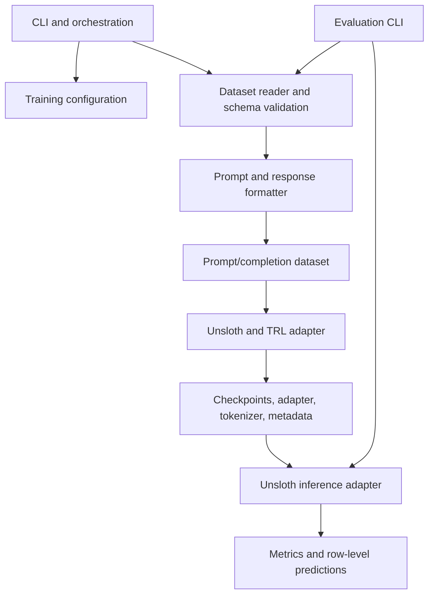

# Architecture

## Phase 4 training path

The phase 4 code is organized around a thin command-line boundary and separate dataset, prompt, configuration, and training modules.

The dataset reader is a pure Python component and can validate a CSV member directly inside the ZIP archive.

The prompt formatter contains the target-mode rules.

The label-only target contains only `final_label`.

The distilled target contains the four teacher rationale fields, `thought_trace`, and `final_label`.

The training adapter imports Torch, Unsloth, TRL, and Datasets lazily so that schema validation and command help do not require CUDA libraries.

The Unsloth adapter loads a 4-bit student, attaches LoRA modules, trains with TRL `SFTTrainer`, saves checkpoints, and writes the final adapter plus run metadata.

Evaluation loads each saved adapter, uses deterministic generation, extracts the categorical label, and writes aggregate metrics and row-level predictions.

## Data ownership and artifacts

`data/archive.zip` is a source artifact and must be treated as read-only.

Dataset parsing is performed in memory; archive members are not extracted into the repository.

Each training mode has its own output directory to prevent checkpoint collisions.

An output directory owns its checkpoints, final adapter, tokenizer files, training metrics, run metadata, evaluation JSON, and predictions CSV.

Run metadata records the effective training configuration, source archive checksum, and installed model-training package versions.

For resumable training, rerun against the same output directory and select the latest or a specific checkpoint.

## Comparison contract

The baseline and distilled modes use the same annotated training rows, base model, holdout, random seed, and training configuration.

The training response is the only intended experimental difference: categorical label only versus teacher explanations plus categorical label.

The holdout labels were also produced by the teacher.

They are a frozen reference for exploratory comparison and are not independent ground truth because phases 2 and 3 were skipped.

Per-class support must accompany Macro-F1 because the holdout contains one `Ambiguous/Noise` row and six `Identity-Based Hate` rows.

## Failure and recovery

- A missing archive, ZIP member, column, or valid row fails during dataset validation before model loading begins.
- An unknown categorical label fails with a CSV row reference instead of being remapped silently.
- A missing CUDA device stops training with an actionable runtime error.
- An invalid resume path fails before training starts.
- A recoverable interrupted run can continue from a checkpoint in its output directory.
- Evaluation writes predictions alongside metrics so malformed or unparsed model outputs remain auditable.

## Earlier repository modules

`src/` contains phase 1 annotation, provider, processing, and evaluation experiments.

`app/` contains an early inference API, a Streamlit prototype, and mock streaming behavior.

These modules are not dependencies of the phase 4 SFT path.

The app prototype is not a trained model deployment, and the random mock inference class must not be used to report model predictions.

The old `src/finetuner.py` is superseded by the `training/` package because its inputs and trainer invocation do not match the current archive schema.
