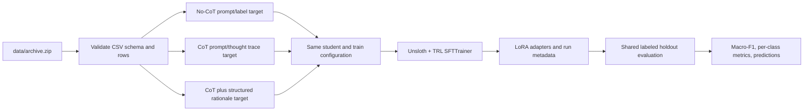
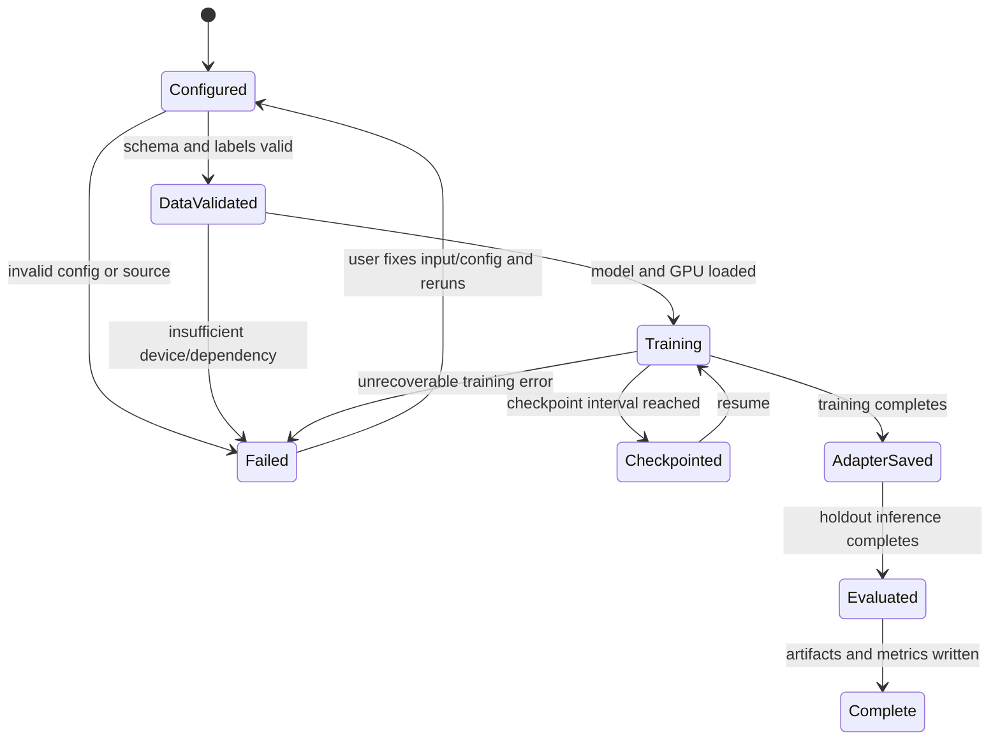

# Phase 4 Training Contract

## Outcome and boundary

Prepare reproducible LoRA supervised fine-tuning for the Vietnamese teacher-labeled dataset, comparing no-CoT, CoT, and CoT plus structured-rationale distillation targets.

The pipeline consumes the phase 1 archive and its labeled holdout, writes adapters and evaluation artifacts outside source data, and can run on a Kaggle GPU.

Phases 2 and 3 are skipped as requested.

## Confirmed inputs and constraints

- Source archive: `data/archive.zip`.
- Preferred training CSV in the archive: `dataset_phase_1.csv` (2,774 rows, one duplicate `input_text`).
- The typo-named `blanced_train_dataset_phase_1.csv.csv` has 3,810 rows but only 2,476 unique input texts, so it is not used as the default training source.
- Labeled test CSV in the archive: `labeled_test_dataset_phase_1.csv` (320 rows).
- Input fields: `input_text` and `input_emotion`.
- Teacher targets: four structured rationale fields, `thought_trace`, `final_label`, and `confidence_score`.
- Existing code and docs point to a Qwen 2.5 3B instruct student, which is the default unless repository inspection finds a stronger blocker.
- The local GPU has 6 GB VRAM; full SFT execution is intended for Kaggle GPU. Local Docker is for environment and data-path validation, not a promise of fitting the 3B training workload on this GPU.
- The held-out set is highly imbalanced: `Ambiguous/Noise` has one example and `Identity-Based Hate` has six, so Macro-F1 must be reported with per-class support and interpreted cautiously.
- The held-out reference labels are teacher-generated; the skipped verification and cultural-review stages provide no independent gold-label evidence.

## Data and model relationship

## Run lifecycle

## Decisions and edge cases

- No-CoT SFT uses `final_label`; CoT SFT adds teacher `thought_trace` and `confidence_score`; CoT plus distilled rationale adds the four structured rationale fields.
- These are exploratory response-target ablations, not a claim that distillation beats human-grounded supervised learning.
- All variants use the same training rows, held-out rows, model family, seed, and training configuration so the comparison isolates the output-target style.
- The archive is read in place; setup must not extract over or rewrite the user's source data.
- Invalid/missing required columns and empty inputs fail before downloading a model.
- Invalid target labels fail with row context instead of being silently mapped.
- Checkpoints and final outputs live under an explicit output directory and can be resumed where supported by TRL.
- Evaluation must report per-class support because the held-out data has sparse classes.
- Full training is not an acceptance check on the local 6 GB GPU; the local container must at least build and expose the CLI/data validation path, while GPU training is intended for Kaggle.

## Acceptance criteria and delivery tasks

- [x] A CLI validates both CSVs inside the archive without modifying them.
- [x] No-CoT, CoT, and CoT plus distilled rationale targets render from the same row schema.
- [ ] An Unsloth `SFTTrainer` run saves a LoRA adapter, tokenizer, checkpoints, config, and logs.
- [ ] The same held-out set can be evaluated and produces Macro-F1 plus per-class support for each run.
- [x] Kaggle instructions show inputs, GPU setup, artifact persistence, and resume usage.
- [x] Docker provides a documented local validation/training environment with explicit GPU requirements.
- [x] README and architecture documentation describe only implemented behavior and identify current result values as pending.

The source/data validation criteria passed under the project-local Python 3.12 virtual environment.

The Docker image build is not yet verified because this machine has the Docker CLI but no running Docker Engine.

Model training and holdout inference remain pending because the local 6 GB GPU is below the intended training target and no Kaggle run has been performed.
